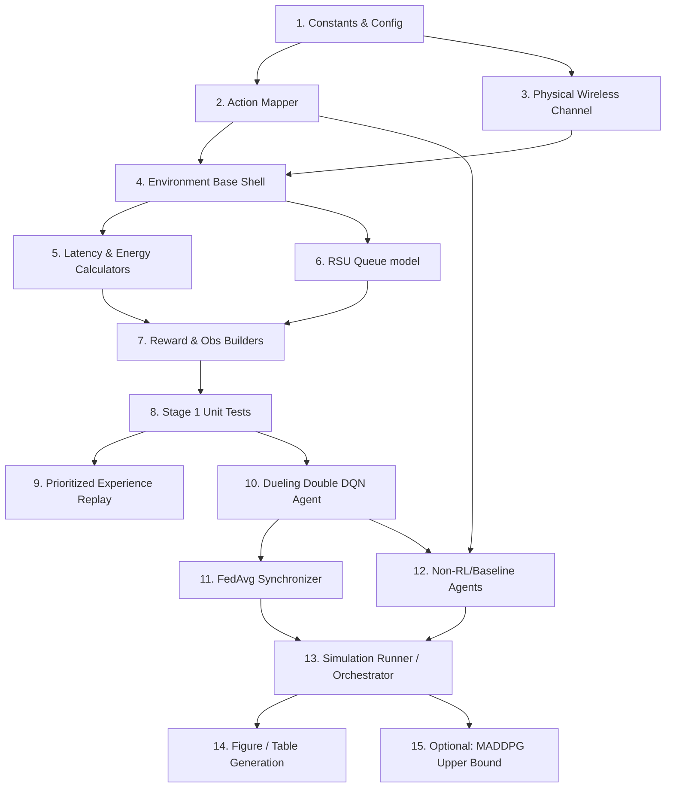

# IMPLEMENTATION_ORDER.md

This document details the recommended implementation sequence. The sequence is structured as a directed dependency graph, starting with zero-dependency foundation modules and building up to integrated run orchestrators and plotting scripts. This bottom-up approach ensures that every component is fully unit-tested and verified before it is integrated into a larger subsystem, thereby minimizing debugging time and efforts.

---

## 1. Dependency Flow

---

## 2. Step-by-Step Implementation Steps

### Step 1: Constants & Configurations (`env/config.py`)
- **Action:** Define CPU frequencies, physical channel parameters (noise, shadowing, frequency), task types, reward weights, scenario probabilities, and environment defaults.
- **Why here:** Every subsequent file depends on these values. Hardcoding must be avoided to keep the baseline clean.

### Step 2: Action Mapper (`env/action.py` or within `env/environment.py`)
- **Action:** Implement mapping of discrete actions $0 \dots 10$ to `rat_idx` and $\rho$. Include safety mask logic that identifies and blocks actions $\{1, 2, 3\}$.
- **Why here:** Decoupling action space mapping from agent networks simplifies action selection and allows unit testing of the safety policy filter early.

### Step 3: Physical Wireless Channel Model (`env/channel.py`)
- **Action:** Implement path loss (3GPP, 5G UMi, WiFi-ax), Jakes fading, SINR calculation, and link success probability.
- **Why here:** The environment depends on physical transmission success to update packet counters. This model has zero dependencies other than constants.

### Step 4: Environment Base Shell (`env/environment.py`)
- **Action:** Set up the structure of the Environment class (`reset()` and `step()`), tracking simulation steps (up to 200), vehicle coordinates (toroidal ring), mobility updates, and task arrival sampling.
- **Why here:** Defines the simulation framework before we integrate physical channel constraints and offloading costs.

### Step 5: Latency & Energy Calculators
- **Action:** Integrate CPU computation and transmission energy equations, as well as the parallel-max latency formulation.
- **Why here:** Computes costs from step transitions, which are critical inputs for both rewards and observation features.

### Step 6: RSU Queue Model
- **Action:** Aggregate offloading demands ($\rho$) per RSU to compute backlog $Q_r$ and channel busy ratio (CBR).
- **Why here:** Feeds queue latency into the latency model and CBR delta into the reward function.

### Step 7: Reward Function & Observation Builder
- **Action:** Implement the normalized 12-D state representation and the $U_{\text{PRR}}$ utility calculation (Eq. 4a).
- **Why here:** These components act as the final interface between the environment and the reinforcement learning agents.

### Step 8: Stage 1 Unit Tests (`tests/test_env.py`)
- **Action:** Write deterministic tests as specified in Section 6 of the Recreation Guide (Latency queue aggregation, Parallel max validation, Safety mask action check, Empirical PRR update, and Reward bounding).
- **Why here:** **CRITICAL GATEWAY.** Do not write a single line of RL agent code until these environment tests pass with 100% mathematical correctness.

### Step 9: Prioritized Experience Replay (PER) (`agents/replay.py`)
- **Action:** Create the priority buffer that tracks TD-errors, calculates sampling probabilities with exponent $\alpha=0.6$, and yields importance sampling corrections with scaled $\beta$.
- **Why here:** Can be implemented and verified independently using dummy transitions.

### Step 10: Dueling Double DQN Agent (`agents/d3qn.py`)
- **Action:** Build the network layers using PyTorch (Dueling split of V and A branches), online/target networks, and action selection policies incorporating the safety task LTE mask.
- **Why here:** Relies on a verified environment state space (12-D) and action space (11 discrete actions).

### Step 11: Federated Learning Aggregator (FedAvg) (`agents/federated.py`)
- **Action:** Write parameter averaging logic that coordinates model weights across vehicles every 50 steps.
- **Why here:** Sits on top of the individual D3QN agents, coordinating their update steps.

### Step 12: Baseline Agents (`agents/baselines.py`)
- **Action:** Implement comparative baselines: Fixed Offloading modes, wu2021 (UCB), yun2022 (GA), jing2019 (Lyapunov), and shao2025 (CoopEC).
- **Why here:** Having these baselines verified allows us to test the simulation orchestrator's mode-handling logic.

### Step 13: Simulation Runner / Orchestrator (`run.py` or `main.py`)
- **Action:** Implement the scenario loading, seed schedules, training (100 episodes) $\to$ evaluation (5 episodes) transition, and JSON metrics exporter.
- **Why here:** Ties environment, RL agents, and baselines together into a unified execution pipeline.

### Step 14: Figure & Table Generation (`plot.py`)
- **Action:** Build script to parse evaluation JSON outputs and generate LaTeX-ready tables and paper-faithful figures.
- **Why here:** Relies on complete simulation logs from the runner.

### Step 15: Optional: MADDPG Agent (`agents/maddpg.py`)
- **Action:** Centralized actor-critic multi-agent system serving as the upper bound comparison.
- **Why here:** Highly complex; isolated from the primary baseline recreation. Should only be pursued once the primary baseline is frozen under `MA-ROPE-v1.0`.
